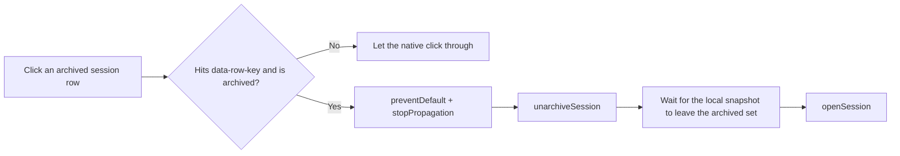

# dsh-archived-open

> **One click, and the archived session opens.** —— Skips the two steps of "unarchive first, then click to open".

[English](README.en.md) · [简体中文](README.md)


A [DeepSeek Harness](https://github.com/deepseek-ai/deepseek-harness) (DSH) plugin. When you click an archived session in the sidebar, DSH only shows "Archived conversations cannot be viewed for now. Please unarchive and try again." This plugin replaces that notice with a real action: unarchive first, then open.

## What problem it solves

The DSH 0.2 sidebar funnels clicks on every session row into the same guard: archived sessions are always blocked, with a notice only.

- You archive often, and often want to look back at old sessions. Install it. One click gets you in, no two-step detour.
- You only want a quick glance and do not want to change archive state. Do not install it. This plugin really does unarchive — the session returns to the normal list.
- You never archive, or never look at archived sessions again. No need to install.

## How it works



- Catch the click first on `document` in the **capture phase**, before DSH's own guard.
- Act only when `[data-row-key="session:<id>"]` matches and that id is in `archivedSessionIds`; the row's "…" menu and archive/pin buttons are out of scope.
- Cannot open right after unarchiving: DSH has a rule that "an archived session cannot stay open", so opening while the local snapshot is not yet updated clears the view immediately. The plugin waits up to 3 seconds for the id to disappear from the archived set, then opens.
- Double clicks and repeated clicks run once; an unarchive failure is not swallowed — one `error` line goes into the log, and the UI does not jump unexpectedly.

## Quick start

```sh
# 1. Clone into ~/.dsh/plugins/dsh-archived-open
git clone https://github.com/gpboyer2/dsh-archived-open.git ~/.dsh/plugins/dsh-archived-open

# 2. Register with the profile (a CLI-managed profile, such as web / main)
dsh plugin --profile <your-profile> add link:$HOME/.dsh/plugins/dsh-archived-open

# 3. Restart DSH
```

> The `desktop` profile is owned exclusively by DeepSeek Harness.app; `dsh plugin --profile desktop …` from the CLI is rejected. For the desktop build, install from the in-app "Plugins" page, or edit the profile's `dependencies` + symlink manually and restart.

The bundled `cordis.patch.yml` inserts the plugin into the plugin tree automatically; no need to edit the profile patch file by hand.

**Verify**: after restart, click any archived session. It unarchives first, then opens directly.

## Core features

| Capability | Description |
| --- | --- |
| **One click opens** | Click an archived session row in the sidebar → unarchive automatically → open that session. |
| **No collateral damage** | The "…" menu, archive/pin buttons, and normal session rows behave as before; double clicks and repeated clicks fire once. |
| **Waits for the snapshot** | After unarchiving, waits for the local snapshot to actually leave the archived set before opening, up to 3 seconds, so the "an archived session cannot stay open" rule does not clear it. |
| **Failures are visible** | A rejected unarchive is not swallowed: the log records `error` and the reason, and the UI does not jump. |
| **Diagnostic log** | Every step is written to `~/.dsh/logs/archived-open.log`, and the latest records can also be fetched via the host trace route. |
| **Zero dependencies** | The client bundle uses only two DSH services: `uiWorkspace` and `workspaces`. |

## Configuration

| Option | Default | Description |
| --- | --- | --- |
| `debug` | `true` | Whether to write the diagnostic log and register the trace route. |
| `logFile` | `~/.dsh/logs/archived-open.log` | Log location. |

Change it in `config:` of `cordis.patch.yml`, or override the plugin row in the profile's patch layer. With `debug: false` the trace route is not registered at all and not a single log line is written.

## Logs and diagnostics

If one click does nothing, check the last lines of `~/.dsh/logs/archived-open.log` first:

| Last entry in the log | Description |
| --- | --- |
| nothing at all | The plugin did not enter the plugin tree: check whether the profile's `dsh.profile.bundles` contains `dsh-archived-open`, and whether the package's `dsh.bundle.patch` is read. |
| nothing after `host-apply` | The host loaded the plugin, but the client half did not reach the browser: check the browser console for bundle errors. |
| nothing after `client-apply` | The plugin is running, but the click did not hit a session row; the `nomatch` line carries the `aria-description` and `data-row-key` actually seen. |
| `hit` → `unarchived` → `opened` | Normal. |
| `error` | The host rejected the unarchive; the reason is at the end of the line. |

`nomatch` is logged once per shape and does not flood the log.

## Architecture

```
lib/index.js          host half: registers the trace route, reads the log
lib/client.js         client half: captures clicks, unarchives, waits for the snapshot, opens the session
cordis.patch.yml      bundle patch: inserts the plugin row
test/                 4 client behavior tests + host trace tests
```

Design constraint: do not take over sidebar rendering, only one click event; all state comes from DSH's public client services, no DOM guessing.

## Development and testing

```sh
npm test
```

4 tests: 1 client behavior test (intercepts archived rows, lets in-row controls through, lets normal rows through, repeated clicks fire once; runs on a DOM mock, no network) and 3 host trace route tests (writes one line, rejects a bad request, the whole route is not registered with `debug: false`).

## Known limits

- **Archived rows in search results cannot be clicked.** That row's DOM has no session id, so the plugin cannot resolve the target, and the native notice still shows. Sidebar rows are unaffected.
- **Opening means unarchiving.** The plugin does not "re-archive automatically after viewing", because that would make the session jump around the list, which is more annoying than the original problem.
- **DSH must be restarted to take effect.** The client bundle is scanned at startup.
- Only targets the DSH 0.2.x desktop/Web client; depends on the two client services `uiWorkspace` and `workspaces`.

## License

[MIT](LICENSE)
