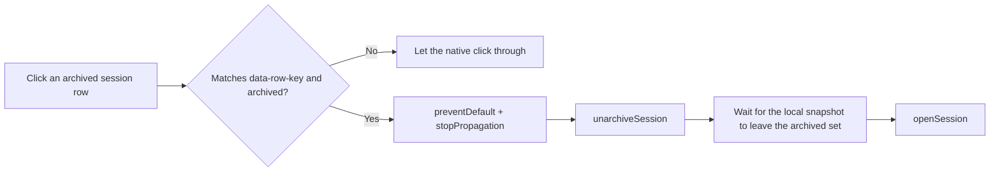

# dsh-archived-open

> Clicking an archived session in the sidebar unarchives it and opens it.

[English](README.en.md) · [简体中文](README.md)


A DeepSeek Harness (DSH) plugin. The DSH 0.2 sidebar funnels clicks on every session row into one guard: archived sessions are always blocked, with the notice "Archived conversations cannot be viewed for now. Please unarchive and try again." This plugin catches the click first on `document` during the capture phase and turns the notice into a real action: unarchive, then open.

## How it works



- Act only when `[data-row-key="session:<id>"]` matches and that id is in `archivedSessionIds`; the row's "…" menu and the archive / pin buttons are out of scope.
- It cannot open right after unarchiving. DSH has a rule that an archived session cannot stay open, so opening before the local snapshot is updated clears the view immediately. The plugin waits up to 3 seconds for the id to leave the archived set, then opens.
- Double clicks and repeated clicks run once.
- An unarchive failure is not swallowed: the log records one `error` line and the reason, and the UI does not jump.

## Quick start

```sh
# 1. Clone to ~/.dsh/plugins/dsh-archived-open
git clone https://github.com/gpboyer2/dsh-archived-open.git ~/.dsh/plugins/dsh-archived-open

# 2. Register with the profile (a CLI-managed profile such as web / main)
dsh plugin --profile <your-profile> add link:$HOME/.dsh/plugins/dsh-archived-open

# 3. Restart DSH
```

The `desktop` profile is owned exclusively by DeepSeek Harness.app, and the CLI rejects it. On the desktop build, install from the in-app "Plugins" page, or edit the profile's `dependencies` to add the symlink by hand, then restart.

The bundled `cordis.patch.yml` inserts the plugin into the plugin tree; there is no need to edit the profile patch file by hand.

Verify: after a restart, click one archived session. It unarchives first, then opens directly.

## Core features

| Capability | Description |
| --- | --- |
| One click opens | Click an archived session row → unarchive → open that session. |
| No false hits | The "…" menu, archive / pin buttons, and normal session rows behave as before; double clicks and repeated clicks fire once. |
| Waits for the snapshot | After unarchiving, wait for the local snapshot to leave the archived set before opening, up to 3 seconds. |
| Failures are visible | When the unarchive is rejected, the log records `error` and the reason, and the UI does not jump. |
| Diagnostic log | Every step is written to `~/.dsh/logs/archived-open.log`, and the latest records can also be fetched through the host trace route. |
| Zero dependencies | The client bundle uses only two services: `uiWorkspace` and `workspaces`. |

## Configuration

| Option | Default | Description |
| --- | --- | --- |
| `debug` | `true` | Whether to write the diagnostic log and register the trace route. |
| `logFile` | `~/.dsh/logs/archived-open.log` | Log location. |

Change it in `config:` of `cordis.patch.yml`, or override the plugin row in the profile's patch layer. With `debug: false` the trace route is not registered and no log line is written.

## Logs and diagnostics

If one click does nothing, check the last lines of `~/.dsh/logs/archived-open.log` first:

| Last entry in the log | Description |
| --- | --- |
| nothing at all | The plugin is not in the plugin tree: check whether the profile's `dsh.profile.bundles` includes `dsh-archived-open`, and whether the package's `dsh.bundle.patch` is read. |
| nothing after `host-apply` | The host loaded the plugin, but the client half did not reach the browser: check the browser console for bundle errors. |
| nothing after `client-apply` | The plugin is running, but the click did not hit a session row; the `nomatch` line carries the `aria-description` and `data-row-key` that were actually seen. |
| `hit` → `unarchived` → `opened` | Normal. |
| `error` | The host rejected the unarchive; the reason is at the end of the line. |

`nomatch` is logged once per shape and does not flood the log.

## Architecture

```
lib/index.js          host half: registers the trace route, reads the log
lib/client.js         client half: captures clicks, unarchives, waits for the snapshot, opens the session
cordis.patch.yml      bundle patch: inserts the plugin row
test/                 1 client behavior test + 3 host trace tests
```

It does not take over sidebar rendering and handles one click event. All state comes from DSH's public client services; the plugin does not guess at the DOM.

## Tests

```sh
npm test
```

4 tests: 1 client behavior test (intercepts archived rows, lets in-row controls through, lets normal rows through, repeated clicks fire once; runs on a DOM mock, no network) and 3 host trace route tests (writes one line, rejects a bad request, the whole route is not registered with `debug: false`).

## Limits

- Archived rows in search results cannot be clicked. That row's DOM has no session id, so the plugin cannot resolve the target and the native notice still shows; sidebar rows are unaffected.
- Opening means unarchiving. The plugin does not re-archive after viewing; that would make the session jump around the list.
- DSH must be restarted to take effect. The client bundle is scanned at startup.
- Only the DSH 0.2.x desktop / Web client is supported; the plugin depends on the two client services `uiWorkspace` and `workspaces`.

## License

[MIT](LICENSE)
