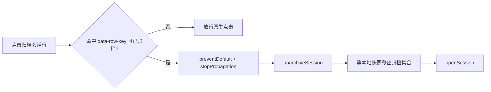

# dsh-archived-open

> 一句话：点侧栏里的归档会话，自动取消归档并直接打开。

[简体中文](README.md) · [English](README.en.md)


一个 DeepSeek Harness（DSH）插件。DSH 0.2 的侧栏把所有会话行点击统一交给一个守卫处理：归档会话一律拦下，只弹一句「已归档对话暂时无法查看，请取消归档后查看」。本插件在 `document` 的 capture 阶段先接住点击，把提示换成真实动作：取消归档，然后打开。

## 工作方式



- 命中 `[data-row-key="session:<id>"]` 且该 id 在 `archivedSessionIds` 里才动手；行内的「…」菜单、归档 / 置顶按钮不在拦截范围。
- 取消归档后不能立刻打开。DSH 有一条「归档会话不能保持打开」的规则，本地快照还没更新就打开，视图会被立刻清掉。插件最多等 3 秒，等它从归档集合里消失再开。
- 双击、连点只执行一次。
- 取消归档失败不吞错：日志记一条 `error` 与原因，界面不会跳走。

## 快速开始

```sh
# 直接从 GitHub 安装（命令行管理的 profile，如 web / main）
dsh plugin --profile <你的profile> add github:gpboyer2/dsh-archived-open

# 本地开发：克隆到 ~/.dsh/plugins/dsh-archived-open，改用本地软链安装
git clone https://github.com/gpboyer2/dsh-archived-open.git ~/.dsh/plugins/dsh-archived-open
dsh plugin --profile <你的profile> add link:$HOME/.dsh/plugins/dsh-archived-open

# 重启 DSH
```

`desktop` profile 由 DeepSeek Harness.app 独占，命令行会被拒。桌面版在应用内「插件」页安装，或手动改 profile 的 `dependencies` 加软链后重启。

包内的 `cordis.patch.yml` 会把插件插进插件树，不用手改 profile 的 patch 文件。

验证：重启后点一个归档会话，它会先取消归档，然后直接打开。

## 核心功能

| 能力 | 说明 |
| --- | --- |
| 单步打开 | 点归档会话行 → 取消归档 → 打开该会话。 |
| 不误触 | 「…」菜单、归档 / 置顶按钮、普通会话行照旧；双击、连点只触发一次。 |
| 等快照 | 取消归档后等本地快照移出归档集合再打开，最多 3 秒。 |
| 失败可见 | 取消归档被拒时记 `error` 与原因，界面不跳走。 |
| 诊断日志 | 每一步写进 `~/.dsh/logs/archived-open.log`，也可经宿主 trace 路由取最近记录。 |
| 零依赖 | 客户端 bundle 只用 `uiWorkspace`、`workspaces` 两个服务。 |

## 配置

| 配置 | 默认 | 说明 |
| --- | --- | --- |
| `debug` | `true` | 是否写诊断日志并注册 trace 路由。 |
| `logFile` | `~/.dsh/logs/archived-open.log` | 日志位置。 |

在 `cordis.patch.yml` 的 `config:` 里改，或在 profile 的 patch 层覆盖插件行。`debug: false` 时 trace 路由不注册，日志一行不写。

## 日志与诊断

点了一次没反应，先看 `~/.dsh/logs/archived-open.log` 最后几行：

| 日志里最后出现 | 说明 |
| --- | --- |
| 什么都没有 | 插件没进插件树：检查 profile 的 `dsh.profile.bundles` 是否含 `dsh-archived-open`，以及包的 `dsh.bundle.patch` 是否被读到。 |
| `host-apply` 之后没有了 | 宿主加载了插件，但客户端半部没送到浏览器：看浏览器控制台有没有 bundle 报错。 |
| `client-apply` 之后没有了 | 插件在跑，但点击没命中会话行；`nomatch` 行会带上实际看到的 `aria-description` 与 `data-row-key`。 |
| `hit` → `unarchived` → `opened` | 正常。 |
| `error` | 取消归档被宿主拒绝，行尾带原因。 |

`nomatch` 每种形态只记一次，不会刷屏。

## 架构

```
lib/index.js          宿主半：注册 trace 路由、读日志
lib/client.js         客户端半：capture 点击、取消归档、等快照、打开会话
cordis.patch.yml      bundle patch：插入插件行
test/                 客户端行为 1 条 + 宿主 trace 3 条
```

不接管侧栏渲染，只接一个点击事件；所有状态来自 DSH 公开的客户端服务，不猜 DOM。

## 测试

```sh
npm test
```

4 条：客户端行为 1 条（拦截归档行、放行行内控件、放行普通行、连点只触发一次，跑在 DOM mock 上，不出网），宿主 trace 路由 3 条（写入一行、坏请求拒绝、`debug: false` 时整条路由不注册）。

## 边界

- 搜索结果里的归档行点不了。那一行 DOM 上没有会话 id，插件拿不到目标，仍旧走原生提示；侧栏的行不受影响。
- 打开即取消归档。插件不做「看完自动重新归档」，那会让会话在列表里跳来跳去。
- 必须重启 DSH 才生效。客户端 bundle 是启动时扫描的。
- 只适配 DSH 0.2.x 的桌面 / Web 客户端，依赖 `uiWorkspace`、`workspaces` 两个客户端服务。

## 许可证

[MIT](LICENSE)
